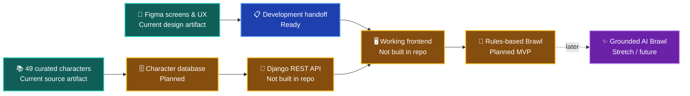

# ⚔️ MARVEL CLASH — PROJECT HQ

> **One project. One product goal. Clear evidence.**
> Make Marvel characters easy to explore and turn character comparisons into entertaining, understandable Brawls.

**This is an additional visual project dashboard; it does not replace or change the five original project documents.** Counts below are a checked snapshot of GitHub **Issue labels** on **October 23, 2026**. They are not proof that the separate GitHub Projects board cards have been moved.

## 🧭 Jump to the right place

| 🎯 Project | 📚 Reference and evidence |
| --- | --- |
| [🎨 Primary Figma prototype](https://www.figma.com/design/Ofvhw6kOEZxiq2Vz9ECJ15) | [🧑‍🤝‍🧑 Personas](https://www.figma.com/design/Ofvhw6kOEZxiq2Vz9ECJ15?node-id=42-20) · [🌐 Context diagram](https://www.figma.com/design/Ofvhw6kOEZxiq2Vz9ECJ15?node-id=324-2) · [🛤️ Primary journey](https://www.figma.com/design/Ofvhw6kOEZxiq2Vz9ECJ15?node-id=42-66) |
| [📖 Official README](README.md) | [📋 Updated proposal](Project_Description.md) · [🥊 Brawl backlog](BRAWL_BACKLOG.md) |
| [📅 Midpoint Scrum plan](MIDPOINT_SCRUM_PLAN.md) | [📌 All GitHub Issues](https://github.com/satya1130/CSC325-Capstone/issues) · [🗂️ Projects tab](https://github.com/satya1130/CSC325-Capstone/projects) |
| [🎞️ Original prototype video](https://youtu.be/8gb0xLyrx2o) | Earlier short Figma walkthrough — **not** the new required 8–10 minute midpoint recording |
| [🧩 Open a new issue](https://github.com/satya1130/CSC325-Capstone/issues/new/choose) | Choose a new **feature/story**, **bug**, or **process task** form |
| [🌿 Review pull requests](https://github.com/satya1130/CSC325-Capstone/pulls) | Every member must contribute a meaningful branch/PR; review and merge must be real |

## 📊 Five-stage work board — issue-label snapshot

| Stage | Color key | Count | View all |
| --- | --- | ---: | --- |
| 📦 Product Backlog |  | **27** | [Future and not-yet-started tasks](https://github.com/satya1130/CSC325-Capstone/issues?q=label%3A%22kanban%3Abacklog%22) |
| 🟦 Ready |  | **12** | [Actionable next tasks](https://github.com/satya1130/CSC325-Capstone/issues?q=label%3A%22kanban%3Aready%22) |
| 🔶 In Progress |  | **3** | [Work supported by current activity](https://github.com/satya1130/CSC325-Capstone/issues?q=label%3A%22kanban%3Ain-progress%22) |
| 🟪 In Review |  | **5** | [Artifacts needing correction or team sign-off](https://github.com/satya1130/CSC325-Capstone/issues?q=label%3A%22kanban%3Ain-review%22) |
| ✅ Done |  | **7** | [Completed *documented artifacts*](https://github.com/satya1130/CSC325-Capstone/issues?q=label%3A%22kanban%3Adone%22) |

**These labels are used to give GitHub Issues a meaningful status spread.** The real GitHub Projects board must be opened and synchronized separately by a member with Projects edit permission; labels alone do **not** move cards between Projects columns.

### 📦 Product Backlog — most features are still here

- [#45 Member login and persistent sessions](https://github.com/satya1130/CSC325-Capstone/issues/45)
- [#46 Secure guest/member/admin permissions](https://github.com/satya1130/CSC325-Capstone/issues/46)
- [#47 Database-backed Favorites](https://github.com/satya1130/CSC325-Capstone/issues/47) · [#48 Search/filter API](https://github.com/satya1130/CSC325-Capstone/issues/48)
- [#49 Deterministic Brawl MVP](https://github.com/satya1130/CSC325-Capstone/issues/49) · [#50 Move/counter source rules](https://github.com/satya1130/CSC325-Capstone/issues/50)
- [#51 Optional match history/replay](https://github.com/satya1130/CSC325-Capstone/issues/51) · [#52 Automated tests](https://github.com/satya1130/CSC325-Capstone/issues/52)
- [#53 Accessible frontend checks](https://github.com/satya1130/CSC325-Capstone/issues/53) · [#54 Image attribution audit](https://github.com/satya1130/CSC325-Capstone/issues/54)

### 🟦 Ready — requirements known, not automatically built

- [#28 Initialize Django REST backend](https://github.com/satya1130/CSC325-Capstone/issues/28)
- [#41 Figma-to-code screen/component handoff](https://github.com/satya1130/CSC325-Capstone/issues/41)
- [#42 Character/image import manifest](https://github.com/satya1130/CSC325-Capstone/issues/42)
- [#43 Character API response contract](https://github.com/satya1130/CSC325-Capstone/issues/43)
- [#44 Confirm team handles, owners and deadlines](https://github.com/satya1130/CSC325-Capstone/issues/44)
- [#32 Collect actual feature-branch/PR evidence](https://github.com/satya1130/CSC325-Capstone/issues/32)

### 🔶 In Progress — real ongoing coordination

- [#31 Review Kanban board/cards](https://github.com/satya1130/CSC325-Capstone/issues/31)
- [#33 Prepare new 8–10 minute midpoint demo](https://github.com/satya1130/CSC325-Capstone/issues/33)
- [#40 Align issue-status labels and real evidence](https://github.com/satya1130/CSC325-Capstone/issues/40)

### 🟪 In Review — evidence exists, acceptance pending

- [#24 Figma prototype navigation and sharing review](https://github.com/satya1130/CSC325-Capstone/issues/24)
- [#25 Persona/context-diagram review](https://github.com/satya1130/CSC325-Capstone/issues/25)
- [#27 Architecture and test-plan review](https://github.com/satya1130/CSC325-Capstone/issues/27)
- [#38 Reconcile 49-character spreadsheet/image mapping](https://github.com/satya1130/CSC325-Capstone/issues/38)
- [#39 Account-screen interaction and hotspot QA](https://github.com/satya1130/CSC325-Capstone/issues/39)

### ✅ Done — evidence-backed design/source artifacts only

- [#34 Original 49-character source content collected](https://github.com/satya1130/CSC325-Capstone/issues/34)
- [#35 Prototype guide and UX journey documented](https://github.com/satya1130/CSC325-Capstone/issues/35)
- [#36 Four login prototype variants exist](https://github.com/satya1130/CSC325-Capstone/issues/36)
- [#37 Four-persona and user-journey boards exist](https://github.com/satya1130/CSC325-Capstone/issues/37)
- Older resolved board-setup issues [#1](https://github.com/satya1130/CSC325-Capstone/issues/1), [#2](https://github.com/satya1130/CSC325-Capstone/issues/2) and [#3](https://github.com/satya1130/CSC325-Capstone/issues/3) are preserved, not deleted.

**Critical:** "Done" on a *Figma artifact* is **not** "Django backend built." Reviews for those design materials are still open in their own issues.

## 🏗️ What is implemented versus what is planned?

| Workstream | Verified now | Not yet evidenced in GitHub |
| --- | --- | --- |
| Character content | 49 records + source slides; one 'Valkryie'/'Valkyrie' spelling issue flagged | Database models, import, API-backed profiles |
| UX/design | Figma light/dark, desktop/mobile, personas, context, scripted Brawl | Real responsive HTML app and full device tests |
| Accounts | Figma demo account states and navigation | Real account security, guest/member/admin permissions, persistence |
| Brawls | Figma scripted example and results | Rules-based computed fights, validated moves, AI integration |
| Testing | Four planned categories in README | Runnable automated test suite and verifiable results |
| Collaboration | Documentation commits, Issues and proposed tasks | Each person's actual feature branch, PR, peer review and merge |

## 👥 Team planning, not historical credit

| Group member | Proposed upcoming focus | Identity / assignment note |
| --- | --- | --- |
| **Satya** | Frontend/API integration, project coordination, Brawl result/replay | Verified handle: [@satya1130](https://github.com/satya1130) |
| **Salih** | Source data import support, proposal, test/process evidence | Verified handle: [@JustEmre12](https://github.com/JustEmre12) |
| **Aryan** | Django backend, fighter/rules logic, API design | GitHub handle unconfirmed |
| **Kyle** | Character artwork manifest, responsive UI and accessibility | GitHub handle unconfirmed |

New Issues rotate **proposed** tasks among the four people, but this is **not** credit for work already completed. Confirm workload and account handles at [#44](https://github.com/satya1130/CSC325-Capstone/issues/44). Never list an AI assistant as a GitHub author/co-author.

## 📐 Working agreement and definition of Done

1. Choose an Issue with clear acceptance criteria, a genuine owner, and a realistic due date. Check [the midpoint plan](MIDPOINT_SCRUM_PLAN.md).
2. Implement the work on **your own meaningful feature branch**; commit only changes you actually made.
3. Open a PR linking the Issue. Include setup/tests/screenshots and whether a feature is Figma-only or executable.
4. Have another teammate review. Resolve comments and merge only after the acceptance criteria are satisfied.
5. Move the **actual GitHub Projects card** through Backlog → Ready → In Progress → In Review → Done using evidence. Update the matching Issue status label as well.
6. For code tasks, **Done means working code, verified tests and peer review**. For design/artifact tasks, Done means the specifically named file or screen exists and passes its own acceptance criteria.

## 🎯 Midpoint presentation evidence

Show the problem/product goal, final proposal, Figma primary flow, planned architecture, **real working code** (not just clickable Figma), the **real Projects Kanban board**, team responsibilities, confirmed deadlines, risks, and all members' **real** branches/PRs/reviews/merges.

The previously linked 2-minute YouTube walkthrough is not a substitute for the midpoint's planned 8–10-minute team presentation.

---

*Dashboard snapshot: October 23, 2026 · Source-of-truth files remain [README](README.md), [Proposal](Project_Description.md), [Brawl Backlog](BRAWL_BACKLOG.md), [Scrum Plan](MIDPOINT_SCRUM_PLAN.md), and [Supplemental README](Marvel_Clash_README.md). Those five were not edited to make this page.*

## Live implementation-status correction — October 26, 2026

The dashboard above is an October 23 **historical issue-label snapshot**, not a live status board. A Django backend and full 49-character roster were implemented in PR #58, but PR #59 reverted that merge from `main`. A separate recovery branch, `fix/restore-django-reviewed-midpoint`, preserves that implementation for new teammate review; it does not mean the backend is already on `main`. The standalone 12-character roster from PR #57 remains merged. Aryan's post-merge review of PR #58 flagged SQLite-generated ID stability, which has been documented. A GitHub Actions workflow is proposed on the recovery branch, but no passing run should be claimed until GitHub verifies it. The actual Projects board and other teammates' completed work must be confirmed separately from proposed assignments.
