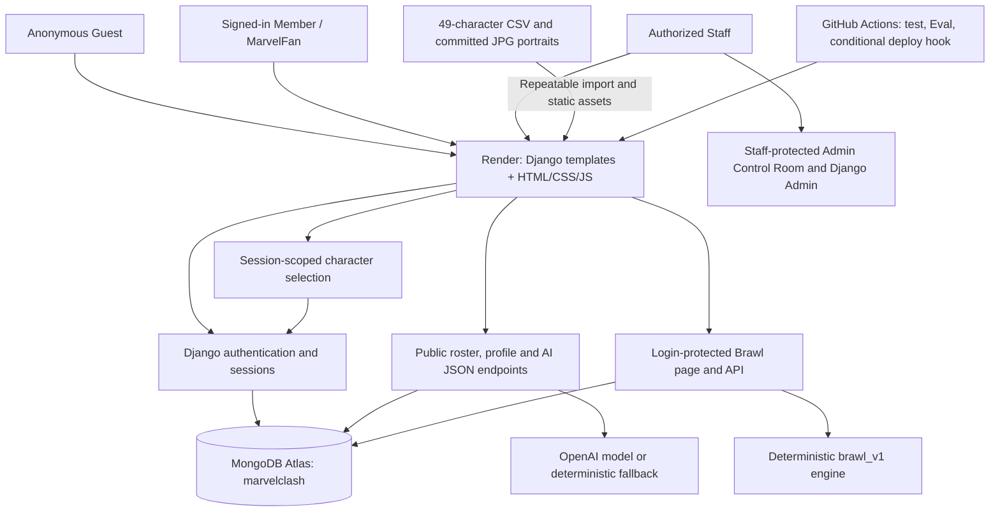

# Marvel Clash — Current Website, Access Model, and Delivery Status

> **Current implementation supplement — November 24, 2026.** This page is an additive reference for the current `main` branch (merge commit `62bbe1dd9885`). It does **not** replace the team's original Figma personas, archived requirements, presentation evidence, or historic Scrum decisions. Refer to the source code and merged PRs for actual functionality. The official site URL was supplied by the group. Source review and passing CI do not independently prove every live Render feature or OpenAI provider call.

## Start here: working links

| Area | Link and notes |
| --- | --- |
| Public website | https://csc325-capstone.onrender.com/ — character roster, search, profiles, AI panels, and selection |
| Member login | https://csc325-capstone.onrender.com/accounts/login/ |
| Member signup | https://csc325-capstone.onrender.com/accounts/signup/ |
| Brawl Arena | https://csc325-capstone.onrender.com/brawl/ — login required |
| Admin Control Room | https://csc325-capstone.onrender.com/accounts/admin-control/ — staff required |
| Django admin | https://csc325-capstone.onrender.com/admin/ — Django staff permissions apply |
| Character API | https://csc325-capstone.onrender.com/api/characters/ — public read-only roster endpoint |
| Repository / implementation | https://github.com/satya1130/CSC325-Capstone/tree/main/backend |
| Original Figma prototype | https://www.figma.com/design/Ofvhw6kOEZxiq2Vz9ECJ15 |
| Original Figma context diagram | https://www.figma.com/design/Ofvhw6kOEZxiq2Vz9ECJ15?node-id=324-2 |
| Sprint 3 Kanban | https://github.com/users/satya1130/projects/2/views/1 |
| CI / deployment workflows | https://github.com/satya1130/CSC325-Capstone/actions |
| Render console | https://dashboard.render.com/ — account access required; this is not a public app URL |
| MongoDB Atlas console | https://cloud.mongodb.com/ — generic console; no production connection string is committed |

**Navigation note:** Visiting `/brawl/` while signed out redirects to `/accounts/login/?next=/brawl/`. That does not mean the root homepage requires login: visitors can open `/` and browse publicly.

## From four Figma examples to real access levels

The *Figma prototype* used illustrative personas/account states named **Guest**, **MarvelFan**, **Aryan**, and **Salih (Admin)**. Those demonstrated separate screens in a click-through prototype that did not have production authentication. **Aryan** and **MarvelFan** were example ordinary users, **Salih (Admin)** illustrated administrative access, and **Guest** illustrated the signed-out experience. These are important *historical design artifacts*, not four database roles.

The *implemented Django website* has **three meaningful access levels**:

| Access level | Implemented behavior |
| --- | --- |
| Guest / anonymous visitor | View the homepage, 49-character roster, profiles, search, filters, and public AI features. May also select/change/remove a character using session-scoped `/api/selection/` (this is the *current implementation*, even if the team's desired future UX reserves selection for registered users). Cannot run a Brawl. |
| Registered member — informally “MarvelFan” | Any normally signed-in Django user; username need not literally be `MarvelFan`. Inherits public access, plus the Brawl page and protected `POST /api/brawl/start/`. Signup uses a username/email/password; login and logout use Django authentication with hashed passwords and sessions. |
| Staff/admin | Authenticated account with `is_staff=True` can open `/accounts/admin-control/`. The built-in `/admin/` site additionally requires appropriate model permissions or superuser status. Public signup **does not** create staff members. |

A signed-in user **does not** receive a custom MarvelFan role in the database; “MarvelFan” is a product/persona label for regular members. The special Marvel-logo click sequence and hidden Figma admin entry flow were **not** implemented in the production accounts app. The Admin Control Room is currently a protected landing page linking to Django admin, not a replica of the Figma admin dashboard. Never document prototype PINs or passwordless account examples as real credentials.

**To align intended experience with code later:** the team should decide whether guest character selection should remain public and whether compare should move out of Future Scope. As of this audit, guest selection works in code and the comparison feature is **not implemented**. Do not write that all comparisons work just because the prototype showed them.

## What is implemented versus deferred

| Epic / feature | Actual current repository status | Evidence |
| --- | --- | --- |
| Epic 1: Search, browse, filter | Implemented; roster from MongoDB-backed Django API | Issues #4–#6; merged roster/filter work |
| Epic 2: Descriptions, powers, JPG images | Implemented; 49-row source CSV and 49 local portrait assets | Issues #7–#9; importer/API tests |
| Epic 3: Signup/login/logout, permissions, select character | Implemented in Django; member sessions, staff guard; guest selection is presently allowed | [PR #105](https://github.com/satya1130/CSC325-Capstone/pull/105); issues #45, #46, #10 |
| Epic 4: AI summary, roster-grounded recommendations, character Q&A | Implemented with an OpenAI path and offline fallback; whether actual production requests reach OpenAI requires live checking | [PRs #94–#101](https://github.com/satya1130/CSC325-Capstone/pulls?q=is%3Apr+is%3Amerged); issues #13–#15; mocked CI Eval is not live provider validation |
| Epic 5: Choose two fighters, deterministic battle, turn display / HP / winner | Implemented in Django; `brawl_v1` server remains authoritative | [PR #103](https://github.com/satya1130/CSC325-Capstone/pull/103); issues #19, #20, #49 |
| Arcade presentation | Merged portrait-dash/hit animations, floating damage, winner announcement, auto-play/pause and reduced-motion styles | [PR #110](https://github.com/satya1130/CSC325-Capstone/pull/110) |
| Compare characters side-by-side | **Future Scope**, not a live comparison feature | FUT-01 issue #11 |
| Persistent favorites and saved Brawl history | **Future Scope**, not part of current account persistence | FUT-02 issue #12, task #47, FUT-09 issue #51 |
| AI-generated combat moves, team-vs-team battles, character-specific attack sprites | **Not implemented**; ideas for later, not current acceptance claims | FUT-07 issue #22 for AI actions; team Brawls not among the 15 active user stories |
| Nine extra character profiles proposed in PR #104 | **Not merged**; proposal closed November 24; current tracked roster remains 49 | [PR #104](https://github.com/satya1130/CSC325-Capstone/pull/104) |

### Technical connections

- **Backend:** `backend/marvelclash/` settings/URLs; `backend/accounts/` signup, login, staff permission and tests; `backend/characters/` roster, API, session selection, Brawl, AI features, CSS/JS/templates.
- **Database:** Django `django_mongodb_backend`, database `marvelclash`, credentials loaded through private Render `MONGODB_URI`. Django users use normal `auth` permissions. Source CSV/image assets are in GitHub; production credentials are not.
- **Deployment:** Render with Gunicorn/WhiteNoise; GitHub Actions tests with temporary MongoDB and mocked AI Eval. The November 22 main-branch workflows passed after #110, but passing a deploy-hook step is not an independent live-site functional test.
- **Frontend:** the working public frontend is under `backend/characters/templates/` and `backend/characters/static/`. The `frontend/roster/` 12-record standalone sample is historical, not the deployed app.
- **API:** `GET /api/characters/`, detail `GET /api/characters/<ObjectId>/`, summary, recommendations, `POST .../ask/`, session selection `GET/POST/DELETE /api/selection/`, and authenticated `POST /api/brawl/start/`. See source route modules. The character list/detail API itself is read-only; not every endpoint in the whole Django project is read-only.

## Current quality / review status

- All **15 active story issues** were closed in GitHub, but before this documentation cleanup nine still carried `kanban:backlog` or `kanban:ready` labels. An issue's label is **not automatically** the GitHub Projects V2 Status field; verify the separate board after issue-label updates.
- Preserve the 15 active stories, exactly five epics, nine deferred FUT-series stories, and supporting work. Do not promote compare, favorites, AI battle moves, or team battles into the completed scope.
- Preserve older reports as **dated history**: the October Figma four-user demo, SQLite-era architecture, initial MVP, and November 10 migration. Do not rewrite those prior milestones to look like they always had authentication.
- The public site and login screenshot are known from the team; this audit checked repository source and CI but **did not independently execute a complete live production walkthrough** for signup, admin login, AI provider access, or rendered mobile Brawl playback.
- Follow-up verification recommended: actual Render guest/member/admin flows, portrait and playback behavior on phone/desktop, privacy of Render secrets, accessibility, art attribution, and documentation link checks.

## Source-of-truth and change policy

The root [README](../README.md) introduces the product; [Project_Description](../Project_Description.md) records the current product scope *plus historical backlog*; [BRAWL_BACKLOG](../BRAWL_BACKLOG.md) retains Epic 5 acceptance criteria; [PROJECT_HUB](../PROJECT_HUB.md) and [repository map](REPOSITORY_MAP.md) are indexes. GitHub merged code, actual issues, CI logs, and production verification have priority over an older document's `Current` heading. Historical artifacts are **preserved, not deleted or silently rewritten**. Any new admin permission must be granted by an authorized administrator, not by revealing credentials or adding a backdoor.
