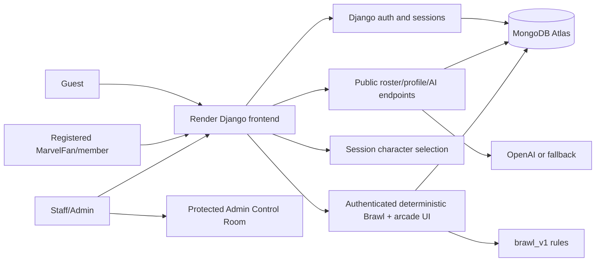
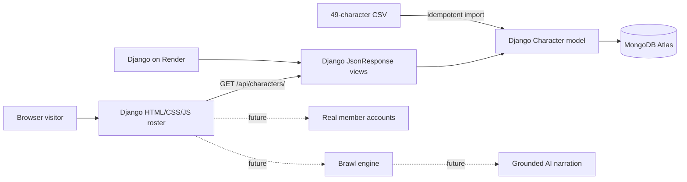

# Marvel Clash — Feature and Technical Status

> **Updated November 24, 2026.** Current repository implementation is tracked below; the November 10 roster-only matrix and original October 27 midpoint views remain as dated history. The public website is [Marvel Clash](https://csc325-capstone.onrender.com/); the separate [current architecture/roles guide](CURRENT_WEBSITE_STATUS_2026-11-24.md) explains the Figma-to-Django transition. Source/CI verified; production end-to-end checks still required.

## Product goal

Help Marvel fans discover and understand characters and experience entertaining, explainable Brawls. The Django site now contains real member login, staff permissions, three AI character tools and deterministic two-fighter Brawls with arcade animation. Side-by-side comparison remains Future Scope, not a completed feature.

## Current feature matrix

| Feature | Django application | Figma | Status / follow-up |
| --- | --- | --- | --- |
| 49-character roster | **Implemented:** MongoDB Atlas + repeatable CSV import + API | Yes | Manually verified after Render deployment; editorial review still needed |
| Search by character name | **Implemented:** case-insensitive partial search | Yes | Automated Django/Node checks exist; smart prefix-first enhancement remains in separate PR #86 |
| Filter by powers or ability | **Implemented:** populated power dropdown and matching filter | Yes | Tested in GitHub Actions; manually reported working live |
| Filter Hero / Villain / Antihero | **Implemented** | Yes | Source-category review remains desirable |
| Profiles with descriptions and abilities | **Implemented** | Yes | Data quality review remains |
| Character JPG portraits | **Implemented:** all 49 local JPGs | Yes | Third-party artwork use/attribution needs review |
| Read-only JSON character API | **Implemented** | N/A | ObjectId detail URLs, `q`, `powers` and `category` filters |
| Repeatable 49-character import | **Implemented:** `update_or_create` | N/A | CI checks record count and idempotency |
| Responsive/accessibility behavior | Basic responsive UI and keyboard labels | Yes | Complete manual accessibility/browser audit pending |
| Public deployment | **Implemented:** Django on Render, database on MongoDB Atlas | N/A | November 10 manually verified; monitor future deploys |
| Real member login and permissions | **Implemented**: Django signup/login/logout, hashed passwords, session access, staff guard (PR #105) | Figma examples historically simulated | Live role/login journey should be acceptance-tested |
| Session character selection | **Implemented** for guests and members through `/api/selection/` | Figma illustrated selection | Not a permanently saved favorite |
| Persistent favorites, side-by-side comparisons | **Not implemented** (FUT-01/FUT-02) | Demonstrated | Deferred scope; no false live claims |
| Two-fighter selection / combat engine | **Implemented**: login-protected `/brawl/`, `POST /api/brawl/start/`, deterministic `brawl_v1`, health, turns, winner (PR #103) | Scripted original prototype | Server rules are testable; verify production flow |
| Arcade visual battle effects and auto-play | **Implemented**: portrait dash/hit animation, floating damage, winner display, reduced-motion support (PR #110) | Original arcade idea | Manual phone/browser acceptance pending |
| AI-generated battle actions, character-specific sprites, saved replay | **Not implemented** | Figma examples were illustrative | Future Scope; do not confuse with deterministic game |
| AI character summary, recommendations, Q&A | **Implemented** with OpenAI/fallback paths (PRs #94–#101) | Prototype ideas | CI mocked; production provider usage unverified |

## Current integrated architecture (November 24)

See [current integrated reference](CURRENT_WEBSITE_STATUS_2026-11-24.md). The diagram below is preserved as a **November 10 roster-only architecture snapshot**.

## Historical November 10 architecture

**Technology:** Python 3.14, Django 6.1.2, `django-mongodb-backend==6.1.0`, MongoDB Atlas, vanilla JavaScript/CSS and Django templates, Gunicorn/WhiteNoise on Render, GitHub Actions with temporary MongoDB 7 test services. The API uses Django `JsonResponse`, not Django REST Framework.

## Current website routes and endpoints

- [Homepage](https://csc325-capstone.onrender.com/) — public roster, AI panels and session selection.
- `GET/POST /accounts/signup/`, `GET/POST /accounts/login/`, `POST /accounts/logout/` — real Django account flows.
- `GET /accounts/admin-control/` — staff only; `/admin/` uses Django administration permissions.
- `GET/POST/DELETE /api/selection/` — session character selection, available to guest/member in current code.
- `GET /brawl/` and `POST /api/brawl/start/` — authenticated deterministic Brawl.
- `GET /api/characters/<objectid>/summary/`, `GET /api/characters/<objectid>/recommendations/`, `POST /api/characters/<objectid>/ask/` — public character AI features; OpenAI or fallback.

## Historical November 10 roster API endpoints

- `GET /api/characters/` returns an alphabetized `{"characters":[...]}` object.
- Optional `q`, `powers`, and `category` queries filter the list.
- `GET /api/characters/<objectid>/` returns one character or JSON 404 for malformed/unknown IDs.
- Unsupported POST requests return HTTP 405.
- `/` serves the API-backed searchable roster, images, dropdown filters, and profiles.

Character IDs are **string-encoded MongoDB ObjectIds**, not SQLite numeric IDs. See the [API contract](CHARACTER_API_CONTRACT.md).

## Verification and development history

- Original Django MVP: [PR #58](https://github.com/satya1130/CSC325-Capstone/pull/58), restored in [PR #60](https://github.com/satya1130/CSC325-Capstone/pull/60).
- MongoDB migration, CI and ObjectId compatibility: [PR #88](https://github.com/satya1130/CSC325-Capstone/pull/88).
- GitHub's Django tests and four-stage CI/CD passed on `main` after the migration. The test stage uses a temporary MongoDB service; passing a Render deploy hook alone is not a live-site health check.
- The live roster, character images, profiles, name search, category filters, and power filters were manually confirmed working after Atlas network access was configured on November 10.
- Original user-story acceptance and team evidence: [November 8 evidence](NOV8_STORY_EVIDENCE.md) and [README](../README.md).

## Quality gaps and future work

1. **Art/data:** Review Marvel artwork usage/attribution and verify character descriptions, categorizations, and the `Valkryie` spelling against the original source before changing any production identity or filename.
2. **Testing:** No complete automated browser end-to-end, load, or combat-invariant suite yet.
3. **Security and accessibility:** Run Django's deployment checks and a real browser/device accessibility pass; store production secrets in Render settings, never in Git.
4. **Future app features:** Side-by-side compare, persistent favorites, saved match history/replay, optional AI-generated battle actions, and richer attack animations. Secure authentication, session selection and deterministic combat are already in merged code.

**Historical note:** The October 27 version of this document described SQLite, eight tests, missing images/filters, and an undeployed MVP. Those statements were accurate for that earlier snapshot but are now superseded by the MongoDB migration and Render deployment.
