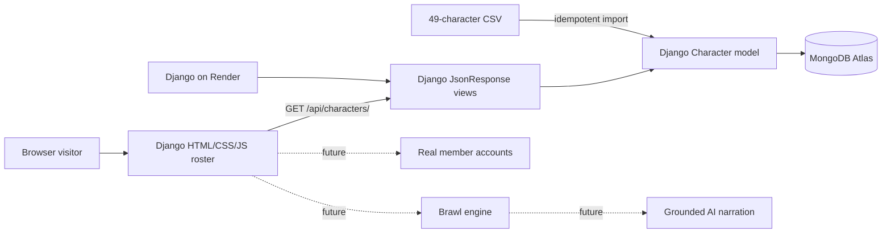

# Marvel Clash — Feature and Technical Status

> **Updated November 10, 2026.** This document started as the October 27 midpoint snapshot and is now updated to reflect the live Django/MongoDB Atlas roster. The team's original Figma Brawl prototype is separate from implemented functionality.

## Product goal

Help Marvel fans discover and understand characters, compare possible fighters, and eventually experience an entertaining, explainable Brawl. Only the character-exploration roster is implemented and deployed so far.

## Current feature matrix

| Feature | Django application | Figma | Status / follow-up |
| --- | --- | --- | --- |
| 49-character roster | **Implemented:** MongoDB Atlas + repeatable CSV import + API | Yes | Manually verified after Render deployment; editorial review still needed |
| Search by character name | **Implemented:** case-insensitive partial search | Yes | Automated Django/Node checks exist; smart prefix-first enhancement remains in separate PR #86 |
| Filter by powers or ability | **Implemented:** populated power dropdown and matching filter | Yes | Tested in GitHub Actions; manually reported working live |
| Filter Hero / Villain / Antihero | **Implemented** | Yes | Source-category review remains desirable |
| Profiles with descriptions and abilities | **Implemented** | Yes | Data quality review remains |
| Character JPG portraits | **Implemented:** all 49 local JPGs | Yes | Third-party artwork use/attribution needs review |
| Read-only JSON character API | **Implemented** | N/A | ObjectId detail URLs, `q`, `powers` and `category` filters |
| Repeatable 49-character import | **Implemented:** `update_or_create` | N/A | CI checks record count and idempotency |
| Responsive/accessibility behavior | Basic responsive UI and keyboard labels | Yes | Complete manual accessibility/browser audit pending |
| Public deployment | **Implemented:** Django on Render, database on MongoDB Atlas | N/A | November 10 manually verified; monitor future deploys |
| Real member login and permissions | **Not implemented** | Simulated | Account/session and permission work |
| Persistent favorites, comparisons | **Not implemented** | Demonstrated | Data models, API, UI and tests |
| Two-fighter selection / combat engine | **Not implemented** | Scripted interactions | Deterministic rules and battle invariants |
| AI Brawl narration, animation, replay | **Not implemented** | Illustrative | Grounding, model integration, safeguards |

## Current architecture

**Technology:** Python 3.14, Django 6.1.2, `django-mongodb-backend==6.1.0`, MongoDB Atlas, vanilla JavaScript/CSS and Django templates, Gunicorn/WhiteNoise on Render, GitHub Actions with temporary MongoDB 7 test services. The API uses Django `JsonResponse`, not Django REST Framework.

## Live endpoints

- `GET /api/characters/` returns an alphabetized `{"characters":[...]}` object.
- Optional `q`, `powers`, and `category` queries filter the list.
- `GET /api/characters/<objectid>/` returns one character or JSON 404 for malformed/unknown IDs.
- Unsupported POST requests return HTTP 405.
- `/` serves the API-backed searchable roster, images, dropdown filters, and profiles.

Character IDs are **string-encoded MongoDB ObjectIds**, not SQLite numeric IDs. See the [API contract](CHARACTER_API_CONTRACT.md).

## Verification and development history

- Original Django MVP: [PR #58](https://github.com/satya1130/CSC325-Capstone/pull/58), restored in [PR #60](https://github.com/satya1130/CSC325-Capstone/pull/60).
- MongoDB migration, CI and ObjectId compatibility: [PR #88](https://github.com/satya1130/CSC325-Capstone/pull/88).
- GitHub's Django tests and four-stage CI/CD passed on `main` after the migration. The test stage uses a temporary MongoDB service; passing a Render deploy hook alone is not a live-site health check.
- The live roster, character images, profiles, name search, category filters, and power filters were manually confirmed working after Atlas network access was configured on November 10.
- Original user-story acceptance and team evidence: [November 8 evidence](NOV8_STORY_EVIDENCE.md) and [README](../README.md).

## Quality gaps and future work

1. **Art/data:** Review Marvel artwork usage/attribution and verify character descriptions, categorizations, and the `Valkryie` spelling against the original source before changing any production identity or filename.
2. **Testing:** No complete automated browser end-to-end, load, or combat-invariant suite yet.
3. **Security and accessibility:** Run Django's deployment checks and a real browser/device accessibility pass; store production secrets in Render settings, never in Git.
4. **Future app features:** Secure authentication, favorites, compare flows, battle model, explainable combat, optional AI narrative, and replay.

**Historical note:** The October 27 version of this document described SQLite, eight tests, missing images/filters, and an undeployed MVP. Those statements were accurate for that earlier snapshot but are now superseded by the MongoDB migration and Render deployment.
