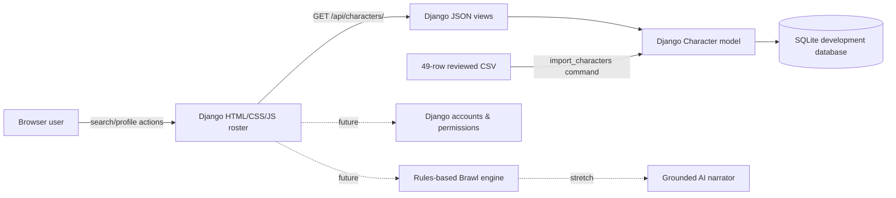

# Marvel Clash — Midpoint Feature and Technical Status

> **Verified snapshot:** 2026-10-27 UTC. Figma design examples are not the same as executable features. Current source branch: `main` following PR #60. Do not claim public deployment or live AI.

## Finalized product goal
Help Marvel fans and newcomers discover, understand and compare Marvel characters, then experience an entertaining, explainable Brawl. Prefer truthful, source-backed character powers and a deterministic battle baseline before adding variation or optional AI narrative.

## Feature matrix

| Feature | Django MVP on `main` | Figma representation | Remaining work / evidence |
| --- | --- | --- | --- |
| 49-character roster | **Working**: SQLite, CSV and API | Yes | Cross-check source workbook |
| Character name search | **Working**: browser JavaScript | Yes | Add browser-level tests |
| Name, description, powers profile | **Working**: basic modal | Yes | Improve consistency and data quality |
| Read-only list/detail REST API | **Working**: Django JSON endpoints | N/A | Stable IDs, API integration tests |
| 49-row repeatable importer | **Working**; new idempotency unit tests proposed | N/A | Source validation and provenance |
| Image portraits and category filters | **Not implemented**; fields nullable | Yes | Approved artwork, image manifest and category mapping |
| Accessible/mobile coded UI | Basic responsive CSS | Yes | Manual device/keyboard WCAG review |
| Sign up/sign in/admin/guest authorization | **Not implemented** | Simulated PIN/roles only | Django auth, permission tests and session persistence |
| Saved favorites and comparisons | **Not implemented** | Demonstrated | Database models, UI and tests |
| Select two fighters | **Not implemented** | Demonstrated | Validate two distinct characters |
| Health bars, combat rounds and outcome | **Not implemented** | Scripted example | Rules engine and deterministic tests |
| Brawl explanations/replay | **Not implemented** | Scripted result | Match state, replay and explanation |
| Grounded AI narration and animation | **Not implemented; stretch** | Visual concept only | Reviewed moves/counters, non-invented powers, safeguards |
| Public deployment | **Not deployed** | N/A | Host/secrets/static files/security checklist |

## Architecture

**Technology:** Python 3.14, Django 6.1.2 per pinned requirements, SQLite for local MVP, Django templates, vanilla JavaScript and CSS, GitHub CI, Figma for design. These are not Django REST Framework viewsets; the API is implemented using Django `JsonResponse`.

## Working endpoints
- `GET /api/characters/` returns `{"characters":[...]}`, alphabetized by name.
- `GET /api/characters/<id>/` returns one JSON character or a structured 404.
- Unsupported POST requests to those URLs return 405.
- `/` serves the API-backed searchable roster.
- Character IDs are SQLite-generated stringified primary keys, stable only within the same database.

## Evidence
- Restored MVP: https://github.com/satya1130/CSC325-Capstone/pull/60
- Successful CI on `main`: https://github.com/satya1130/CSC325-Capstone/actions/runs/40442492711
- Original Django work: https://github.com/satya1130/CSC325-Capstone/pull/58
- Figma screens: https://www.figma.com/design/Ofvhw6kOEZxiq2Vz9ECJ15
- Design context: https://www.figma.com/design/Ofvhw6kOEZxiq2Vz9ECJ15?node-id=324-2

## Milestone order
1. Finish MVP cleanup, source proof and end-to-end browser demonstration.
2. Character data and image mapping; permanent IDs and category vocabulary.
3. Fighter selection + comparison and stable rules-based Brawl with invariant tests.
4. Only after the baseline works: AI-grounded explanation, variable moves, optional animations/replay.
5. Security, accessibility, packaging, final group video and documentation.

### Source and quality follow-ups
The CSV includes `Valkryie`, while slideshow art uses `Valkyrie` in the team review issue. Do not silently rename production primary keys without a reviewed migration/import strategy. Other descriptions and pronouns need workbook verification. Import count passing does not prove editorial accuracy. Public images need usage review.

### Test coverage limitations
The published CI currently verifies Django setup, migrations, exactly 49 imports, eight API/homepage unit tests, and passes on Ubuntu. The PR in this midpoint package proposes extra importer/idempotence and admin tests plus standalone Node search tests. There is **no browser E2E suite**, no load testing and no combat invariant testing yet.
